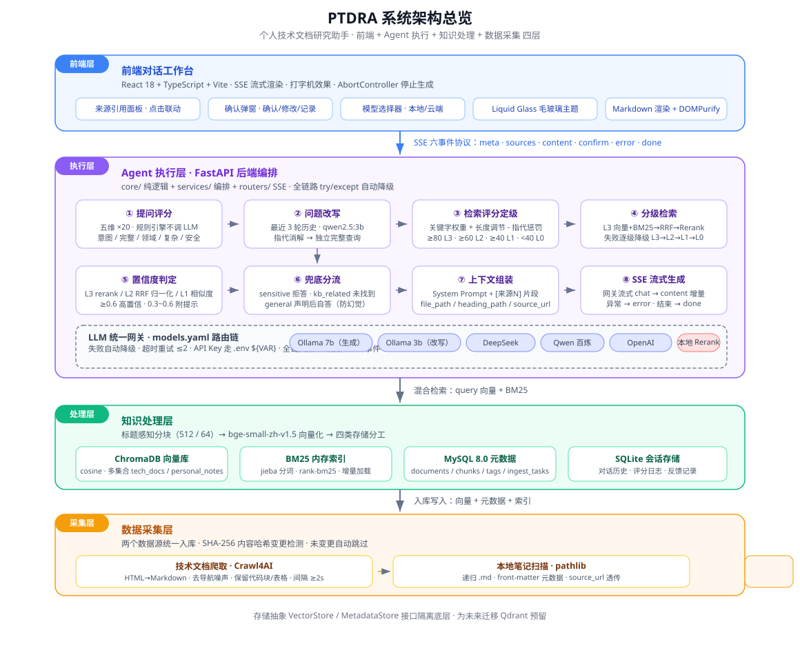
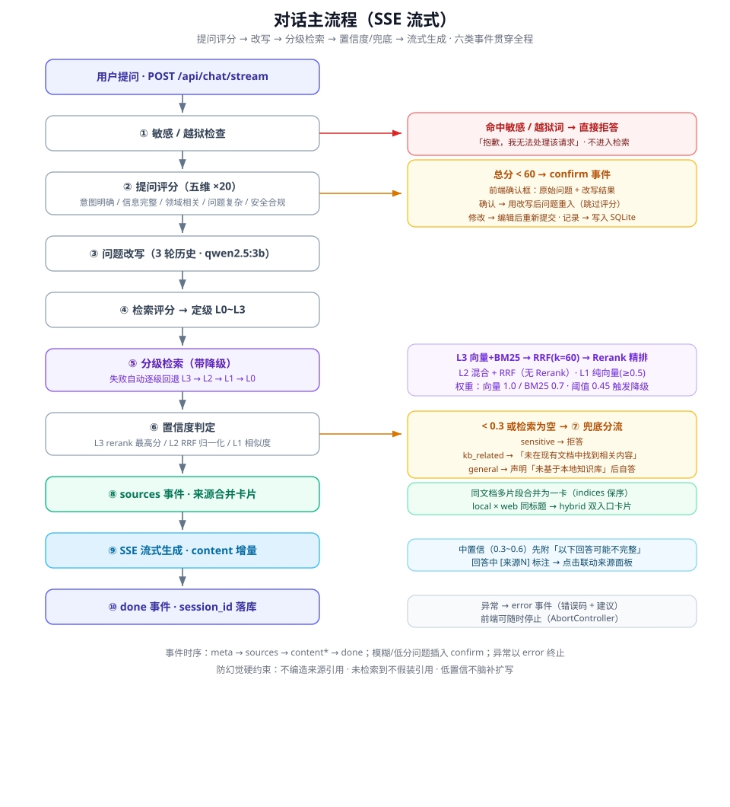

# PTDRA · 个人技术文档研究助手

> **P**ersonal **T**echnical **D**ocumentation **R**esearch **A**ssistant

把本地 Markdown 笔记和爬取的技术文档统一接入知识库，用 **混合检索 + RRF 融合 + Rerank 精排** 回答你的技术问题。答案带 `[来源N]` 引用标注，点击即可联动来源面板、打开原文文件或网页；问题模糊会先确认理解、绝不编造引用。

**里程碑：V1.3（2026-10-19）** · 后端 120 单测 + 前端 52 单测全绿，`tsc --noEmit` 与 `vite build` 零错误。

---

## 目录

- [功能特性](#功能特性)
- [系统架构](#系统架构)
- [对话主流程](#对话主流程)
- [模块功能](#模块功能)
- [技术栈](#技术栈)
- [API 一览](#api-一览)
- [快速开始](#快速开始)
- [测试](#测试)
- [目录结构](#目录结构)
- [版本历史](#版本历史)
- [已知边界与后续计划](#已知边界与后续计划)

---

## 功能特性

| 特性 | 说明 |
| --- | --- |
| **四级检索降级** | L3 向量+BM25 → RRF 融合（k=60，权重 1.0/0.7）→ Rerank 精排；L2 混合+RRF；L1 纯向量（阈值 0.5）；L0 兜底。检索为空/置信不足/异常时自动逐级回退 |
| **五维提问评分** | 意图明确 / 信息完整 / 领域相关 / 问题复杂 / 安全合规，各 20 分；< 60 分先推 `confirm` 事件让用户确认改写结果，不盲目检索 |
| **多轮问题改写** | 基于最近 3 轮历史用轻量模型（qwen2.5:3b）做指代消解，把「这个怎么配？」改写成独立完整查询 |
| **防幻觉硬约束** | 三类兜底分流：敏感/越狱直接拒答、知识库强相关未命中明确说明「未找到」、通用常识声明「未基于本地知识库」后自答；低置信不硬答、不编造引用 |
| **增量入库** | SHA-256 内容哈希变更检测，未变更文件自动跳过，修改只重入受影响文档（按 `content_hash[:12]` 更新向量 ID） |
| **LLM 统一网关** | `config/models.yaml` 按任务配置路由链（generate / rewrite / embedding / rerank），链上失败自动降级，云端 API Key 走 `.env` `${VAR}` 解析，未配置自动跳过 |
| **来源引用面板** | 同文档多片段合并为一张卡片（`indices` 保序、引用精确联动）；本地笔记 × 网页文档同标题合并为 hybrid 卡，提供「本地打开 + 网页原文」双入口 |
| **SSE 流式对话** | 六类类型化事件（meta / sources / content / confirm / error / done），打字机效果，支持随时停止（AbortController），异常下发友好 `error` 事件 |
| **macOS 风格 UI** | React 对话工作台，Liquid Glass 毛玻璃材质、来源面板侧滑、模型选择器（本地/云端标识、不可用置灰） |

---

## 系统架构

经典四层架构（前端 / Agent 执行 / 知识处理 / 数据采集），各层职责独立、接口解耦：

<p align="center">
  
</p>

- **前端层**：React 对话工作台，通过 SSE 六事件协议与后端通信。
- **Agent 执行层**：FastAPI 后端编排「提问评分 → 改写 → 检索定级 → 分级检索 → 置信度 → 兜底 → 组装 → 流式生成」；LLM 统一网关按 `models.yaml` 路由链自动降级。
- **知识处理层**：标题感知分块 + BGE 向量化，ChromaDB（向量）/ BM25（内存索引）/ MySQL（元数据）/ SQLite（会话）四类存储分工。
- **数据采集层**：Crawl4AI 技术文档爬取 + 本地笔记扫描，统一入库管道，SHA-256 增量去重。

---

## 对话主流程

<p align="center">
  
</p>

事件时序：`meta → sources → content* → done`；模糊/低分问题插入 `confirm`；异常以 `error` 终止。

---

## 模块功能

### 前端 `frontend/src/`

| 模块 | 功能 |
| --- | --- |
| `api/sse.ts` | SSE 字节流分帧解析（跨 chunk 边界、flush 兜底） |
| `api/client.ts` | fetch 客户端：流式对话 / 模型列表 / 入库 / 反馈 |
| `hooks/useChatStream.ts` | 六类事件分发、打字机渲染、AbortController 停止、confirm 状态流转 |
| `hooks/confirmMachine.ts` | 确认框状态机（确认 / 修改 / 记录此问题） |
| `components/ChatContainer.tsx` | 对话容器与整体布局 |
| `components/MessageBubble.tsx` | 消息气泡，`[来源N]` / `[来源N]` 引用识别与点击联动 |
| `components/CitationPanel.tsx` | 来源侧滑面板（「使用了 X 篇文档 / Y 个片段」双口径计数） |
| `components/SourceCard.tsx` | 来源卡片：多片段合并、摘要折叠、hybrid 本地/网页双按钮 |
| `components/ConfirmDialog.tsx` | 人工确认弹窗（展示原始问题与改写结果，支持编辑） |
| `components/ChatInput.tsx` | 自动伸缩输入框（Enter 发送 / Shift+Enter 换行） |
| `components/ModelSelector.tsx` | 模型选择器（本地/云端标识，不可用项置灰禁用） |

### 后端核心逻辑 `backend/app/core/`（纯函数，可离线测试）

| 模块 | 功能 |
| --- | --- |
| `chunker.py` | 标题感知分块（`#`~`####` 层级栈生成 `heading_path`，代码围栏内 `#` 不误判）+ RecursiveCharacterTextSplitter 递归切分（512/64，中文分隔符优先级） |
| `question_scorer.py` | 五维提问评分规则引擎（领域词表 + 近 7 天高频标签辅助相关性判断，含停用词过滤） |
| `query_rewriter.py` | 基于最近 3 轮历史的指代消解改写 |
| `retrieval_scorer.py` | 关键字权重评分（精确 API +30 / 框架 +20 / 概念 +15 / 版本 +10 / 通用 +5 / 模糊 -15）+ 长度调节，定级 L0~L3；词表从知识库元数据自动构建 |
| `retriever.py` | 混合检索器：RRF 融合、Rerank 精排、`retrieve_with_fallback` 逐级降级 |
| `confidence.py` | 置信度计算（L3 rerank 分 / L2 RRF 归一化 / L1 相似度）+ 兜底问题三类分流 |
| `bm25_index.py` | jieba 分词 + BM25Okapi 内存索引，随入库增量加载 |

### 后端服务层 `backend/app/services/`

| 模块 | 功能 |
| --- | --- |
| `note_scanner.py` | `pathlib` 递归扫描 `.md`，解析 front-matter（标题/标签/时间/source_url） |
| `crawler.py` | Crawl4AI 封装：URL 列表 + 深度配置、请求间隔 ≥2s、HTML→Markdown、去导航噪声、保留代码块与表格（降级为 httpx + 清洗） |
| `ingest_pipeline.py` | 增量入库：SHA-256 变更检测 → 删旧向量 → 重分块向量化 → 写元数据；`force_reingest` 全量重入；单文件失败不阻断整批 |
| `vector_store.py` | ChromaDB 实现（多集合 `tech_docs` / `personal_notes`、批量 100/批、按 id/元数据删除） |
| `metadata_store.py` | MySQL 元数据：documents / chunks / tags / document_tags / ingest_tasks 五表 |
| `session_store.py` | SQLite：会话历史、评分日志、反馈记录 |
| `llm_gateway.py` | LLM 统一网关：`chat()/embed()/rerank()`、路由链降级、`${VAR}` 环境变量解析、超时重试 ≤2、`AllProvidersFailedError` 友好报错 |
| `rag_service.py` | RAG 主流程编排 + `merge_chunks_to_sources` 来源卡片合并（路径归一化 + hybrid 标题合并） |
| `base_stores.py` | `VectorStore` / `MetadataStore` 抽象接口，为未来迁移 Qdrant 预留 |

### 后端 Provider 适配层 `backend/app/providers/`

| 模块 | 功能 |
| --- | --- |
| `base.py` | `LLMProvider` / `EmbeddingProvider` / `RerankProvider` 抽象基类 |
| `ollama_provider.py` | Ollama 原生 SDK（chat / stream / is_available） |
| `openai_provider.py` | OpenAI 兼容协议适配（DeepSeek / Qwen 百炼 / OpenAI，仅换 base_url + api_key + model） |
| `local_reranker.py` | 本地 bge-reranker-v2-m3 Cross-Encoder |

### 后端路由 `backend/app/routers/`

| 模块 | 功能 |
| --- | --- |
| `chat.py` | `POST /api/chat/stream`（SSE）、会话历史、反馈记录 |
| `documents.py` | `POST /api/documents/ingest`（BackgroundTasks 异步）、任务状态、文档列表 |
| `files.py` | `GET /api/files/open`：白名单（`data/notes`、`data/tech_docs` 下 `.md`）内用系统默认应用打开本地文件 |
| `health.py` | `GET /api/models` 可用模型清单、`GET /api/health` 三库健康检查 |

---

## 技术栈

| 层次 | 选型 |
| --- | --- |
| 后端框架 | Python 3.11+ · FastAPI · Uvicorn（异步 SSE） |
| 前端 | React 18 · TypeScript · Vite 6 · Vitest · Testing Library |
| 向量库 | ChromaDB（持久化模式 · cosine · 多集合隔离） |
| 元数据 | MySQL 8.0（SQLAlchemy 2 + PyMySQL，utf8mb4） |
| 会话 / 日志 | SQLite |
| Embedding | BAAI/bge-small-zh-v1.5（本地 · 512 维 · 约 90MB） |
| Rerank | BAAI/bge-reranker-v2-m3（本地 Cross-Encoder） |
| LLM | Ollama（qwen2.5:7b 生成 / qwen2.5:3b 改写）+ OpenAI 兼容云端兜底（DeepSeek / Qwen / OpenAI） |
| 混合检索 | rank-bm25 + jieba 分词 · RRF 融合（k=60，向量 1.0 / BM25 0.7） |
| 文本分块 | langchain-text-splitters（RecursiveCharacterTextSplitter） |
| 爬虫 | Crawl4AI（降级路径 html2text + BeautifulSoup） |
| 配置管理 | Pydantic Settings（.env）+ `config/models.yaml` 路由链 |
| 测试 | pytest + pytest-asyncio + httpx（后端）· Vitest + jsdom（前端） |

---

## API 一览

| 方法 | 路径 | 说明 |
| --- | --- | --- |
| POST | `/api/chat/stream` | SSE 流式对话（参数：question / session_id / top_k / model_id） |
| GET | `/api/chat/history/{session_id}` | 获取会话历史 |
| POST | `/api/chat/feedback` | 「记录此问题」落库（SQLite feedback 表） |
| POST | `/api/documents/ingest` | 异步入库（directory / source_type / force_reingest → task_id） |
| GET | `/api/documents/status/{task_id}` | 查询入库任务状态 |
| GET | `/api/documents/list` | 文档列表（可按 source_type 过滤） |
| GET | `/api/files/open?path=` | 白名单内打开本地 `.md`（Windows `os.startfile`） |
| GET | `/api/models` | 可用模型清单（含本地/云端与 available 状态） |
| GET | `/api/health` | 三库健康检查（chroma / mysql / sqlite） |

---

## 快速开始

### 环境前置

- Python 3.11+（已验证 3.12.10）
- Node 18+
- MySQL 8.x（默认 `root / rag_meta`，连接串见 `backend/.env`，参考 `backend/scripts/init_mysql.sql`）
- Ollama（localhost:11434，已拉取 `qwen2.5:7b` + `qwen2.5:3b`）
- 首次启动需要联网下载 `bge-small-zh-v1.5`（~90MB）与 `bge-reranker-v2-m3`（~2GB），默认走 HF 镜像

### 一键启动（Windows）

项目根目录提供两个启动脚本，**双击即可**（自动开窗口跑服务、等待就绪、再打开对应网址）：

| 脚本 | 作用 | 打开的网址 |
| --- | --- | --- |
| `start-backend.bat` | 用项目内 `.venv` 启动 uvicorn | http://127.0.0.1:8000/docs （Swagger 接口文档） |
| `start-frontend.bat` | 启动 Vite dev server（`node_modules` 缺失时自动 `npm install`） | http://127.0.0.1:5173 （对话工作台） |

脚本行为说明：

- 先探测端口，服务已在运行则**直接复用并打开页面**，不重复启动
- 后端首次启动需加载嵌入与重排模型，最长等待 5 分钟；超时给出提示但服务仍在后台继续启动
- npm 缓存与镜像固定在项目内（`.npm-cache` / npmmirror）
- 关闭服务：关掉标题为 `python`（后端）或 `npm run dev`（前端）的日志窗口即可

> 两个脚本为 GBK + CRLF 编码（Windows 控制台默认代码页 936），编辑时请勿改成 UTF-8 或 LF。

### 启动自检与自动发现（V1.5.x）

后端启动时对已配置的 Provider 做一次并发健康探测（TTL 30s 缓存，失败即失效重探），并自动发现本地 Ollama 已安装的对话模型：

- **配置模型已安装** → 照常使用，启动日志打出「本地模型在线，共发现 N 个候选」
- **配置模型未安装** → 自动改用本地已装模型兜底（家族匹配优先；generate 取参数量最大、rewrite 取最小），日志打出 `配置模型未安装，已自动选用本地模型: …`，前端右上角下拉框可直接切换
- **Ollama 未启动 / 未装模型** → 结合是否配置了云端 Key 打出相应引导日志；两者皆无则启动日志给出 ER­ROR 诊断
- 自动绑定只在**运行时**生效，不写任何配置文件；配置恢复可用后下一次探测即释放绑定

相关配置（`backend/.env`，详见 `.env.example`）：`PROVIDER_PROBE_ENABLED` / `PROVIDER_PROBE_TIMEOUT_SECONDS` / `PROVIDER_HEALTH_TTL_SECONDS` / `LOCAL_MODEL_EXCLUDE_KEYWORDS`。

配套接口：

| 接口 | 作用 |
| --- | --- |
| `GET /api/models` | 联合清单：配置声明 + 本地发现（含 `source`/`reason`/`parameter_size`），`?refresh=true` 强制重探 |
| `GET /api/providers/status` | 各 Provider 健康快照 + 本地已装模型 + 自动绑定信息，`?refresh=true` 同上 |
| `POST /api/chat/stream` | 全链无可用模型时返回 `E_MODEL_UNAVAILABLE` 结构化引导（SSE `error` 事件，四象限诊断，不点名具体型号） |

### 手动启动

```bash
# 后端
cd backend
pip install -r requirements.txt
cp .env.example .env        # 按需修改 MySQL / Ollama 地址
python scripts/smoke_env.py # 可选：连通性冒烟
uvicorn app.main:app --port 8000

# 前端
cd frontend
npm install --registry=https://registry.npmmirror.com
npm run dev -- --host 127.0.0.1   # Vite dev，/api 代理 → :8000
```

> `--host 127.0.0.1` 用于强制 Vite 绑定 IPv4；不指定时 Vite 默认只监听 `::1`。

### 入库与对话

```bash
# 首次入库（笔记 + 爬取技术文档，二选一或都做）
curl -X POST http://localhost:8000/api/documents/ingest \
     -H 'Content-Type: application/json' \
     -d '{"directory":"data/notes","source_type":"personal_note"}'

curl -X POST http://localhost:8000/api/documents/ingest \
     -H 'Content-Type: application/json' \
     -d '{"directory":"data/tech_docs","source_type":"tech_doc"}'

# 流式对话（SSE）
curl -N -X POST http://localhost:8000/api/chat/stream \
     -H 'Content-Type: application/json' \
     -d '{"question":"FastAPI 的 Depends 依赖注入怎么用？"}'
```

---

## 测试

| 套件 | 数量 | 命令 | 覆盖重点 |
| --- | --- | --- | --- |
| 后端 pytest | 120 | `cd backend && pytest` | 分块边界、五维评分、定级边界、RRF 手算、降级路径、来源卡片合并（17 条）、files 白名单、SSE 事件序列 |
| 前端 vitest | 52 | `cd frontend && npm run test` | SSE 分帧、confirm 状态机、引用联动、SourceCard 21 条渲染/跳转分支 |
| 类型/构建 | — | `npm run typecheck` / `npm run build` | `tsc --noEmit` 与 `vite build` 零错误 |

---

## 目录结构

```
PTDRA/
├── PRD.md                    # 需求文档（唯一需求依据）
├── DEVPLAN.md                # 开发计划 + 阶段验收记录
├── docs/images/              # README 架构图 / 流程图（SVG）
├── backend/                  # Python 后端
│   ├── app/
│   │   ├── main.py           # FastAPI 入口（CORS / 路由注册 / 启动装配）
│   │   ├── state.py          # AppState：单例组件装配
│   │   ├── config.py         # Pydantic Settings（.env）
│   │   ├── core/             # 纯逻辑层：chunker / question_scorer / retriever / ...
│   │   ├── providers/        # Ollama / OpenAI 兼容 / 本地 reranker
│   │   ├── services/         # 三库 + 网关 + 入库管道 + RAG 编排
│   │   ├── routers/          # chat / documents / files / health
│   │   └── models/schemas.py # Pydantic 请求/响应模型
│   ├── tests/                # pytest（asyncio_mode=auto）
│   ├── config/models.yaml    # LLM 路由链
│   ├── data/                 # chroma_db / sessions.db / notes / tech_docs
│   ├── scripts/              # smoke_env · init_mysql.sql · build_domain_terms · sse_client
│   └── requirements.txt
└── frontend/                 # React + Vite + TS
    ├── src/
    │   ├── api/              # SSE 分帧 · fetch client
    │   ├── hooks/            # useChatStream · confirmMachine
    │   ├── components/       # ChatContainer · MessageBubble · CitationPanel · ...
    │   └── styles.css        # Liquid Glass 主题
    ├── package.json
    └── vite.config.ts        # /api → :8000 代理
```

---

## 版本历史

| 版本 | 日期 | 说明 |
| --- | --- | --- |
| V1.3 | 2026-10-19 | 来源面板四项优化：绝对/相对路径归一化合并、隐藏明文地址、剥离摘要标题行、本地×网页 hybrid 双入口卡片；后端 120 / 前端 52 测试全绿 |
| V1.2 | 2026-10-19 | 同一文档多片段合并为一张来源卡片，`[来源N]` 引用精确联动，双口径计数 |
| V1.1 | 2026-10-19 | 来源引用跳转：网页新标签打开原文，本地 md 走白名单接口用默认应用打开 |
| V1 | 2026-10-19 | 首个完整里程碑：8 个开发阶段全部落地，PRD 第 7 章 10 条验收通过 |

详细实现、验收记录与缺陷修复清单见 [DEVPLAN.md](./DEVPLAN.md)；需求约束以 [PRD.md](./PRD.md) 为准。

---

## 已知边界与后续计划

**V1 明确不做**（详见 PRD 附录）：

- 多用户权限体系（个人工具，单人使用）
- 持久化前端会话恢复（session 存 SQLite，前端未做列表恢复 UI）
- Docker Compose 一键启动（依赖宿主机预装 MySQL 与 Ollama）
- 评估体系（50-100 条评估集、CI 指标卡控）
- 知识图谱 / 多知识库隔离 / 定时爬取同步 / 评分反馈闭环

**演进方向（附录 A 备忘）**：

- chunk > 10 万或检索延迟 > 1s 时评估迁移 Qdrant（`VectorStore` 抽象已预留）
- 未来版本评估指标目标：引用命中率 ≥ 85%、忠实度 ≥ 90%、拒答准确率 ≥ 95%、首 Token 延迟 ≤ 1200ms

---

## License

本项目为个人学习与研究项目，暂未指定开源协议；如有需要请联系作者。
